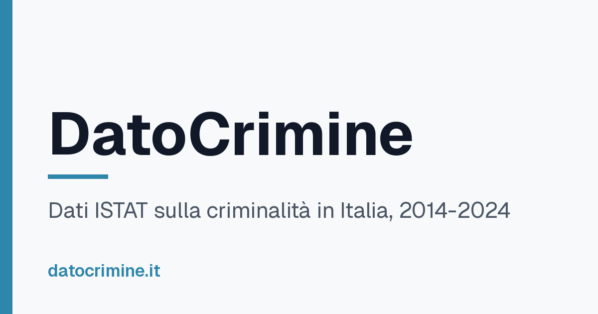

# DatoCrimine

Un progetto open source per rendere accessibili e comprensibili i dati ufficiali ISTAT sulla criminalità in Italia. Nasce dalla constatazione che il dibattito pubblico sulla sicurezza si basa spesso su percezioni e titoli di giornale anziché sui dati: questo sito mette i numeri a disposizione di tutti, con metodologia trasparente e codice aperto.

**[Vai al sito](https://datocrimine.it)**



## Contenuti

La mappa del sito (a sinistra; sul telefono dal pulsante "Mappa") porta a:
- **Home** - frase di sintesi, riquadri d'ingresso con i numeri principali, la tua provincia, i reati di allarme sociale e le pagine di metodo; trend nazionale in fondo
- **Territori** (`/analisi-territoriale`) - mappa coropletica, ranking, trend, tabella delle province (`#province` la apre)
- **Reati di allarme sociale** - 6 reati gravi su tre livelli territoriali; `?reato=` sceglie il reato iniziale
- **Persone denunciate** - autori e vittime per sesso, età e cittadinanza
- **Report 2024** - reati che spiegano la variazione dei delitti (sull'anno prima e sul 2019), mappa variazione regionale, confronto ripartizioni, reati di allarme sociale, percezione vs realtà
- **Capire i dati** - Percezione della sicurezza, Il numero oscuro, Guida alla lettura, Metodologia, Analisi statistiche (`/insights`: trend, composizione demografica, anomalie, confronti, con test statistici), Dati e codice, Chi c'è dietro (`/progetto`)

`/esplora`, il vecchio hub delle pagine dati, resta raggiungibile ma fuori dalla mappa.

## Stack

- Next.js 16 (App Router, TypeScript, React 19)
- Tailwind CSS v4 + shadcn/ui
- Plotly.js (grafici interattivi)
- Deploy: GitHub Pages (export statico, GitHub Actions)

## Sviluppo locale

```bash
npm install
npm run dev
```

Apri http://localhost:3000

## Dati

I dati ISTAT sono in `public/data/` come JSON, pronti per il frontend.

Per rigenerarli dai CSV sorgente (richiede conda + environment `osservatorio`). I dati grezzi di
delitti, autori e vittime (circa 185 MB) non sono nel repository: si scaricano dall'ISTAT con i tre
script `download_*.py`, che possono richiedere molto tempo perché il servizio accetta poche
richieste al minuto.

```bash
conda activate osservatorio
python scripts/download_popolazione.py
python scripts/download_delittips.py
python scripts/download_autvittps.py
python scripts/generate_popolazione.py
python scripts/generate_delittips.py
python scripts/generate_autori_vittime.py
python scripts/csv_to_json.py
python scripts/generate_insights.py
python scripts/generate_report.py
```

## Build

```bash
npm run build
```

Genera il sito statico nella cartella `out/`.

## Licenze

- **Codice**: [AGPL-3.0](LICENSE)
- **Documentazione e testi**: [CC BY-NC-ND 4.0](https://creativecommons.org/licenses/by-nc-nd/4.0/)
- **Dati ISTAT**: [CC BY 3.0 IT](https://creativecommons.org/licenses/by/3.0/it/) - elaborati da DatoCrimine
